<p align="center"></p>

# Bitcoin Market Intelligence

**14 years of minute-level BTC/USD data → product, risk and operations decisions for a retail crypto-investing app.**

<p align="center">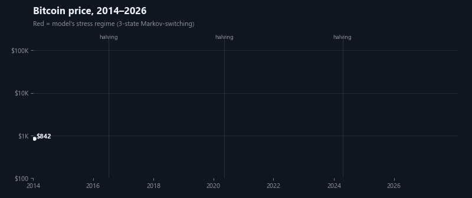</p>

> **Objective.** Use 7.76M one-minute BTC/USD records (2012–2026) to measure how Bitcoin's market structure has changed, and turn the findings into evidence-based recommendations for a crypto app's product, risk and operations teams. Every recommendation is backed by a tested number, its uncertainty, and a metric to track it.

`Python` · `pandas` · `SQL (star schema, CTEs, window functions, gaps-and-islands)` · `Tableau (LOD expressions)` · `statsmodels` · `scikit-learn` · `causal inference (ITS, structural breaks, placebo tests)` · `Markov-switching regimes` · `GARCH / VaR backtesting` · `time-series forecasting` · `permutation tests & bootstrap` · `Monte Carlo` · `cohort analysis` · `Chart.js dashboard`

| Deliverable | What it is |
|---|---|
| [**Live dashboard**](https://goofydynamite.github.io/btc-market-analysis/) · [`dashboard/index.html`](dashboard/index.html) | Interactive HTML dashboard covering both parts, with a working recurring-buy calculator (hosted on GitHub Pages; also opens offline) |
| [**Tableau Public**](https://public.tableau.com/app/profile/deepti.singh.kushwaha/viz/bitcoinanalysis_17932796615520/RecurringBuyDecision) · [`Bitcoin Market Intelligence.twb`](tableau/Bitcoin%20Market%20Intelligence.twb) | Tableau workbook with 3 dashboards (Market Overview, When the Market Trades, Recurring Buy Decision) built from tidy extracts |
| [`notebooks/btc_market_analysis.ipynb`](notebooks/btc_market_analysis.ipynb) | **Part 1:** descriptive and cohort analysis (Q1–Q5) |
| [`notebooks/advanced_analysis.ipynb`](notebooks/advanced_analysis.ipynb) | **Part 2:** causal inference, regime models, forecasting, statistical rigor (A1–A4) |
| [`reports/executive_summary.md`](reports/executive_summary.md) | One-page memo for stakeholders |
| [`sql/`](sql/) → [`reports/sql_results.md`](reports/sql_results.md) | Star schema plus 11 analytical queries, including recurring-buy cohorts, drawdown episodes (gaps-and-islands) and the ETF before/after, all in pure SQL |
| [`reports/sql_reconciliation.md`](reports/sql_reconciliation.md) | SQL vs Python reconciliation: **47/47 headline numbers match** |
| [`src/`](src/) | Reproducible pipeline: ETL → analysis → charts → dashboard |

<details open>
<summary><b>Dashboard tour</b></summary>
<br>
<p align="center">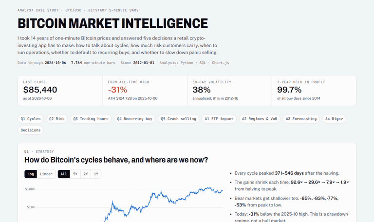</p>
</details>

---

## The business problem

I'm an analyst at a retail crypto-investing app (fictional). Five teams each need a data-backed answer before the 2027 roadmap is locked:

| # | Question | Team | Method |
|---|---|---|---|
| Q1 | How do Bitcoin's market cycles behave, and where are we now? | Strategy | Halving-cycle and drawdown analysis |
| Q2 | How much risk do customers carry, and is it changing? | Risk & Compliance | Volatility, VaR / CVaR by market era |
| Q3 | When does the market actually trade? | Operations / Growth | Hour × weekday liquidity heatmap |
| Q4 | Should **Recurring Buy (DCA)** be the default way to invest? | Product | Cohort analysis: weekly DCA vs lump sum, 142 monthly cohorts |
| Q5 | Should we add a cool-down prompt before selling on crash days? | Product / CX | Event study of 37 one-day drops of 10%+, plus a robustness check at −5% |
| **A1** | Did the **Jan-2024 US spot-ETF launch** change how Bitcoin trades? | Strategy / Risk | Interrupted time series with HAC errors, Quandt–Andrews break scan, 40 placebo dates |
| **A2** | Which **volatility regime** are we in, and can we forecast risk? | Risk | 3-state Markov-switching model; GARCH(1,1)-t (custom MLE); Kupiec VaR backtest |
| **A3** | Can we forecast **next week's hourly volume** for staffing? | Operations | Rolling-origin backtest (91 weeks): seasonal baselines vs gradient boosting |
| **A4** | Which findings are **statistically real**, and what should customers expect? | All | Permutation tests, bootstrap CIs, Benjamini–Hochberg; block-bootstrap Monte Carlo |

## The data

[Kaggle: Bitcoin Historical Data](https://www.kaggle.com/datasets/mczielinski/bitcoin-historical-data), Bitstamp BTC/USD one-minute OHLCV bars.

- **7,764,703 rows**, 2012-01-01 → 2026-10-06, 394 MB CSV
- **Quality checks** ([`data_quality.json`](data/processed/data_quality.json)): 0 nulls, 0 duplicate timestamps, 0 missing minutes, 0 invalid OHLC rows
- **Main quirk:** minutes with no trades are forward-filled (price carried over, volume = 0). That covers 95% of minutes in 2012 and ~30% until 2016, under 4% after 2017. So intraday questions use **2019+**, and cohort questions start in **2014**.
- Volume comes from one exchange, so it measures *relative* activity, not total market size.

## Key findings

### Q1 · Cycles: every halving cycle peaked 12–18 months later, with smaller gains each time
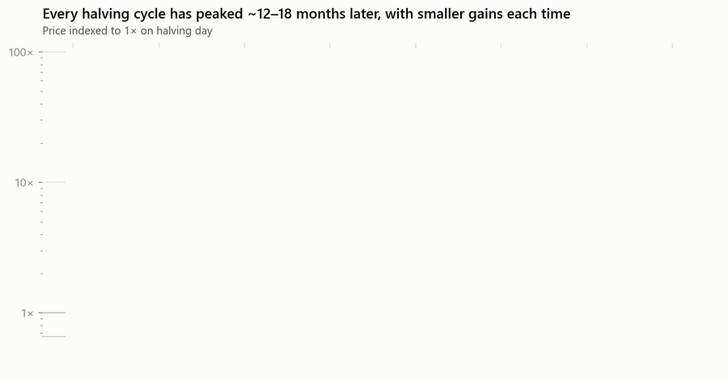

| Halving | Days to peak | Halving → peak | Bear-market low |
|---|---|---|---|
| 2012 | 371 | 92.6× | −85% |
| 2016 | 525 | 29.6× | −83% |
| 2020 | 546 | 7.9× | −77% |
| 2024 | 534 | 1.9× | −53% (so far) |

The timing is consistent, but the gains shrink every cycle. Bitcoin is now **31% below its October 2025 all-time high**.


### Q2 · Risk: volatility has roughly halved
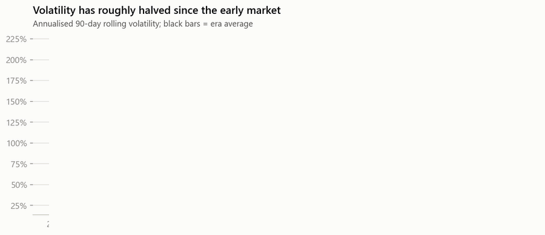

| Era | Ann. volatility | VaR 95% (daily) | Days moving ±10% |
|---|---|---|---|
| 2012–2016 | 91% | −5.7% | 4.8% |
| 2017–2020 | 82% | −6.5% | 4.0% |
| 2021–2023 | 65% | −5.7% | 1.9% |
| 2024–2026 | **47%** | **−3.7%** | **0.4%** |

### Q3 · Trading hours: weekday afternoons in UTC carry the market; weekends trade at about half volume
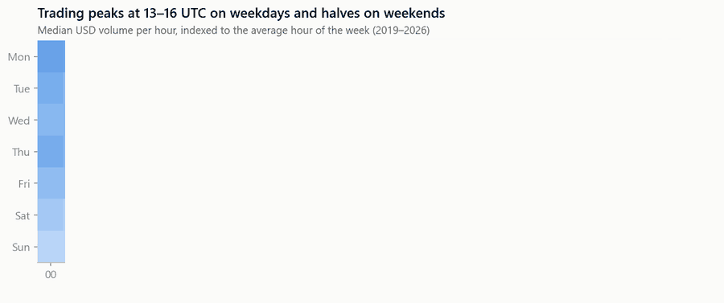

Peak: **Mon–Fri 13:00–16:00 UTC** (up to 2.9× the average hour). Trough: **Sat/Sun 02:00–06:00 UTC** (~0.3×). Saturday trades 42% of a weekday's volume, and Sunday 50%.

### Q4 · Recurring Buy: it doesn't earn more, but it narrows the range of outcomes a lot
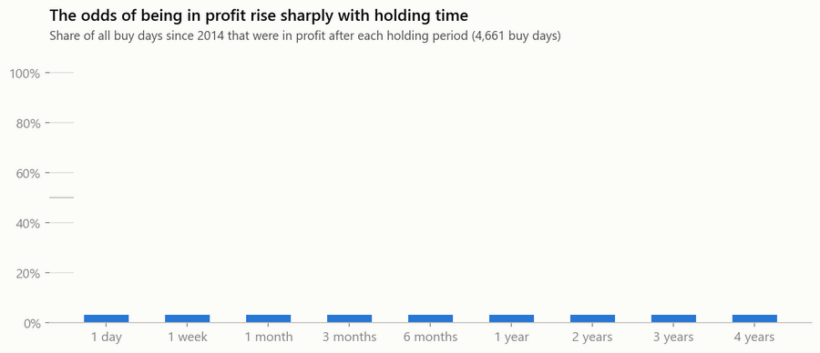

| Held for | DCA in profit | Lump sum in profit | DCA worst cohort | Lump sum worst cohort | DCA beats lump sum |
|---|---|---|---|---|---|
| 12 months | 72% | 68% | −51% | −72% | 36% of cohorts |
| 24 months | 82% | 78% | −48% | −54% | 29% |
| 36 months | 96% | 100% | −10% | +1% | 25% |
| 48 months | 100% | 100% | +34% | +45% | 20% |

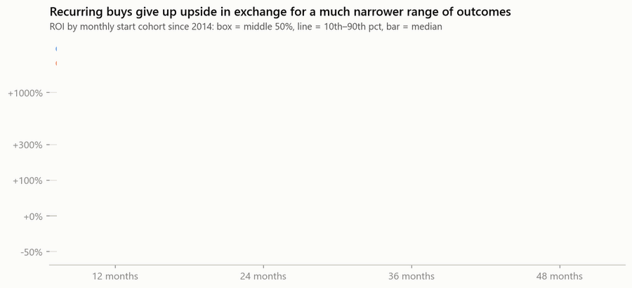
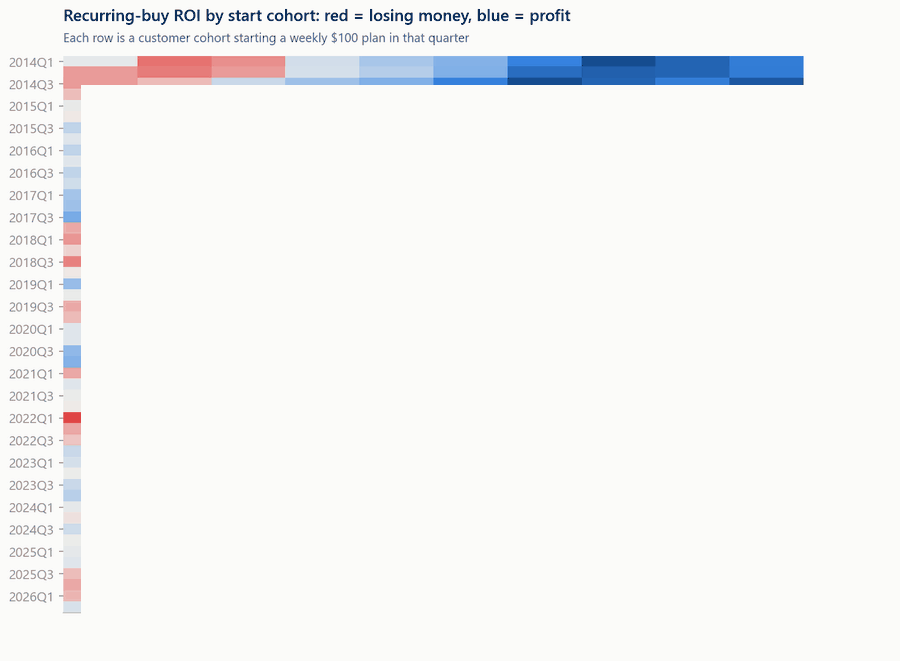

- Lump sum wins on median return because the long-run trend was up (+45% a year since 2014).
- DCA cuts the worst 12-month loss from −72% to −51%, and the spread between cohorts (IQR) by about **60%**.
- The **day of the week** a plan runs on changes the average cost by at most **0.6%**. That isn't worth building a feature for.

### Q5 · Crash selling: the rebound is real but the trigger has nearly disappeared
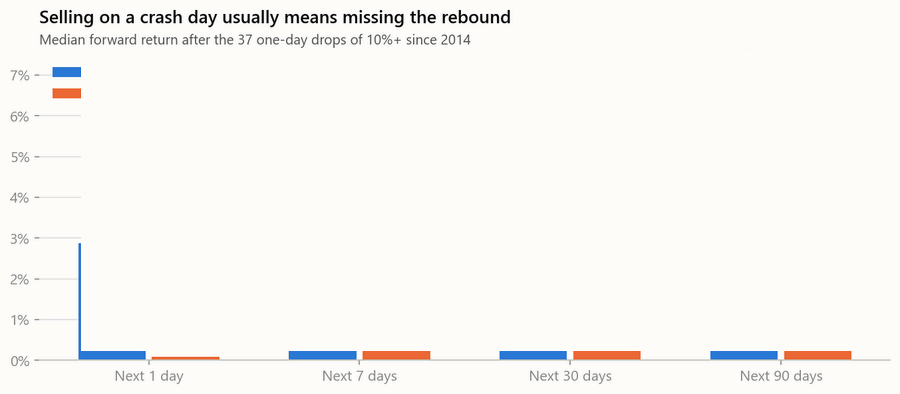

After a −10% day, the next day was up **68%** of the time (baseline 52%), with a median of **+2.9%**. The bounce fades within a year, because crashes cluster in bear markets.

**The robustness check changed the recommendation.** Since 2024 there has been only **one** −10% day. At a looser −5% trigger (127 events) the rebound disappears: the next 30 days were up just 47% of the time, against 55% baseline. A cool-down feature would almost never fire, and a lower trigger has no evidence behind it.

## Part 2 · Advanced analysis

### A1 · The ETF launch didn't cause the volatility decline, but it did pull trading toward US hours
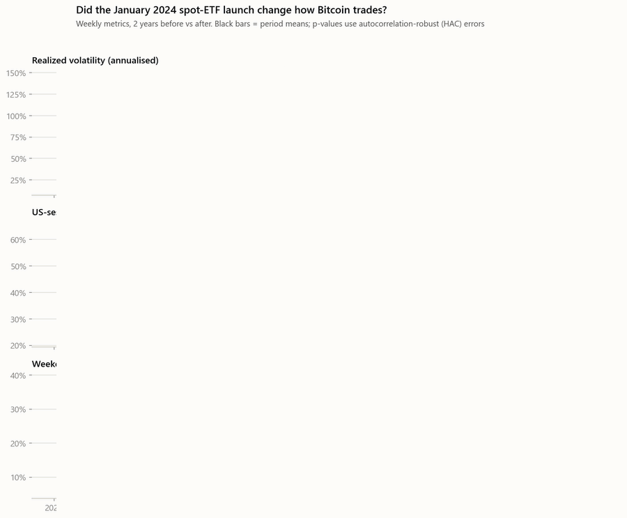

| Metric (weekly) | Before | After | HAC p | Placebo p | Break the data picks |
|---|---|---|---|---|---|
| Realized volatility | 49.1% | 43.6% | 0.28 | 0.18 | **Aug 2022** |
| US-session share of weekday volume | 41.7% | **45.8%** | **0.002** | **0.025** | Oct 2024 |
| Weekend share of volume | 15.1% | 14.8% | 0.66 | 0.80 | Dec 2024 |

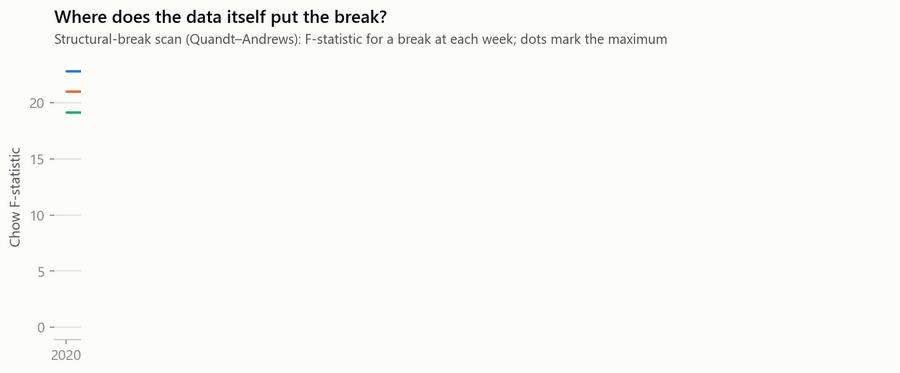

The volatility break sits in **August 2022**, after the Luna/3AC/FTX deleveraging and 17 months *before* the ETF. A single interrupted-time-series model would have said otherwise: extrapolating 2022's falling trend gives a spurious *positive* "effect". That's why the break scan and placebo tests are there. The US-session share rose by about 4 pp and is significant, building through the ETF's first year.

### A2 · Three regimes; fat-tailed GARCH gets the 1-in-100-day loss right
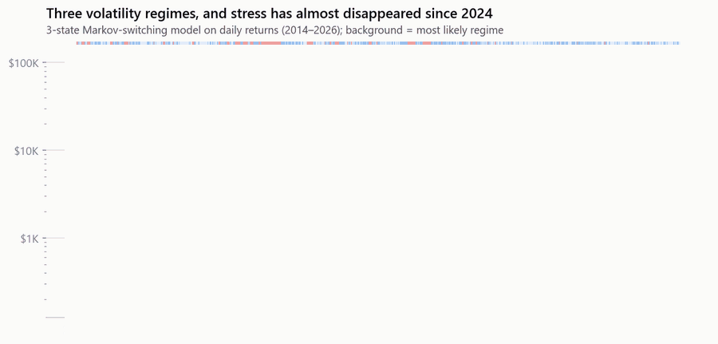

| Regime | Ann. vol | Share of days (2014–26) | Share since 2024 | Expected duration |
|---|---|---|---|---|
| Calm | 20% | 38% | 50% | 4 days |
| Normal | 62% | 45% | 48% | 4 days |
| Stress | 124% | 17% | **2.7%** | **13 days** |

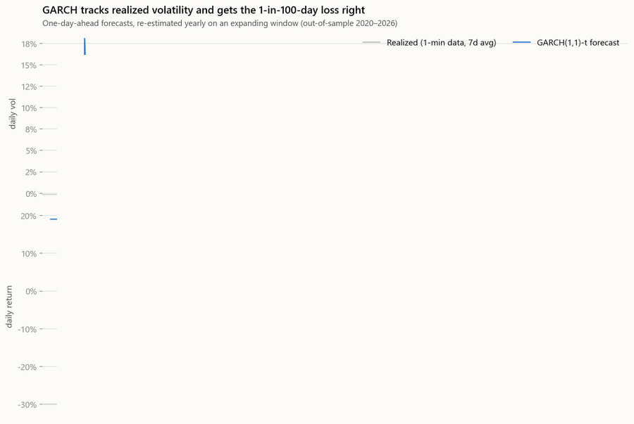

Out of sample (2020–26), scored against **realized volatility from 1-minute returns**, GARCH(1,1)-t beats RiskMetrics EWMA and 30-day historical vol on QLIKE and RMSE. For 99% VaR, **GARCH-t breached 25 times vs 25 expected** (Kupiec p = 0.95). Normal-distribution EWMA breached **51 times**, double its promise. Fitted tail index ν ≈ 3.2.

### A3 · Volume forecasting: the simple model wins
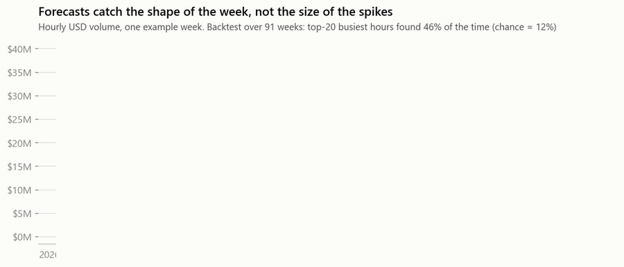

| Model (91-week backtest) | Hourly WAPE | Daily WAPE | Bias | Top-20 busiest hours found |
|---|---|---|---|---|
| Seasonal naive (last week) | 0.77 | 0.44 | 0% | 35% |
| 4-week seasonal mean | 0.60 | 0.38 | −19% | 46% |
| 4-week mean, bias-corrected | 0.65 | 0.40 | +2% | 46% |
| Gradient boosting | 0.64 | 0.42 | 0% | 48% |

The weekly *shape* is predictable (46% of the top-20 hours found, against 12% by chance). The *level* isn't, so gradient boosting adds nothing. WAPE also rewards under-forecasting on spiky data, so the "best" raw model under-staffs by 19%. Pick the metric by the cost of each kind of error.

### A4 · Which part-1 findings survive testing?

| Claim | Estimate | 95% CI | Test | BH-adjusted p | Verdict |
|---|---|---|---|---|---|
| Next-day rebound after −10% days | +2.8 pp | +0.5 to +4.8 | permutation | <0.001 | holds |
| Next-day rebound after −5% days | +0.1 pp | −0.6 to +0.5 | permutation | 0.74 | **not significant** |
| Weekday changes recurring-buy price | 0.3% | – | permutation within week | 0.74 | **not significant** |
| Weekend volume below weekdays | −53% | – | permutation within week | <0.001 | holds |
| Volatility ratio, 2024+ vs 2017–20 | 0.57× | 0.48–0.68× | stationary bootstrap | <0.001 | holds |
| DCA lifts worst-decile 12m ROI vs lump sum | +21 pp | +12 to +28 | cohort bootstrap | <0.001 | holds |

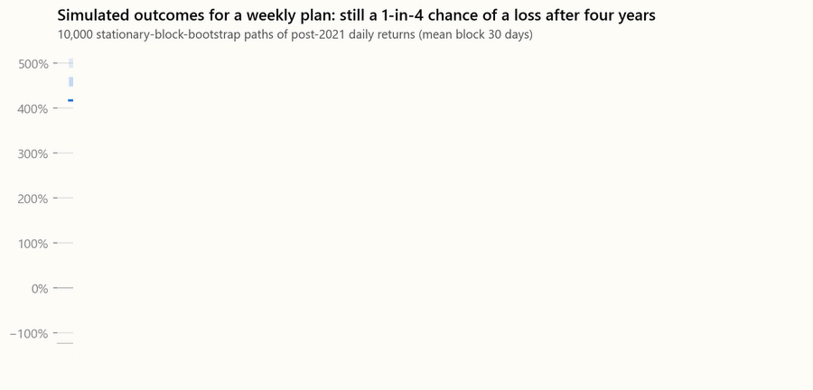

**Monte Carlo (10,000 stationary-block-bootstrap paths):** with post-2021 returns, a weekly plan has a **26% chance of a loss after 4 years**, or 16% resampling all of 2014+. The historical cohort figure was ≈0%, but those windows overlap heavily and come from one exceptional era. Plans and lump sums have the same chance of *some* loss. In the worst 5% of paths, though, the plan loses 59% against **80%** for a lump sum.

## Recommendations

| # | Recommendation | Evidence | Success metric |
|---|---|---|---|
| 1 | Make **weekly Recurring Buy** the default onboarding path, positioned as risk reduction | Worst 12-month outcome −51% vs −72%, ~60% narrower spread | % of new users on a plan; 12-month retention |
| 2 | **Don't build** a "best day to buy" optimiser | Weekday cost difference ≤ 0.6% | Engineering time redirected |
| 3 | Show a **simulated range of outcomes** in the app, not historical odds *(revised by A4)* | Monte Carlo: 26% chance of loss after 4 years vs ≈0% in historical cohorts | Sells in first 90 days; complaint rate |
| 4 | **Deprioritise** the crash-day cool-down; keep it on the backlog | Rebound after −10% days (n = 37), but only one such day since 2024, and no rebound at −5% (n = 127) | Revisit if 90-day volatility returns above 80% |
| 5 | **Maintenance Sat 03:00 UTC**; peak support staffing Mon–Fri 13–17 UTC | 0.3× vs 2.9× average hourly volume | Peak-hour incidents, support SLA |
| 6 | Compute VaR with **fat-tailed GARCH** and alert on the **stress regime**; don't credit the ETF for lower risk *(A1, A2)* | 99% VaR breaches 25 vs 51 (expected 25); volatility break Aug 2022 | VaR breach rate; collateral efficiency |
| 7 | Shift ops and campaign coverage toward **US hours** *(A1)* | US-session share 41.7% → 45.8% (p = 0.002) | Support SLA 14–21 UTC |
| 8 | Staff with the **bias-corrected 4-week volume profile**, not an ML model *(A3)* | Same accuracy as gradient boosting, unbiased, transparent | Weekly forecast bias; understaffed hours |

**If #4 comes back:** randomise at the user level, 50/50, on sell orders placed when BTC is down ≥ 10% on the day. Primary metric: 30-day retention. Guardrails: complaints, and the share of users who later sell at a lower price.

## Limitations

- Four halving cycles is a tiny sample, so the cycle findings describe the past and don't predict the future.
- The ETF analysis has no untreated control market, and the April 2024 halving falls in the same window. Treat it as evidence, not proof of causation.
- Monte Carlo results depend on the sampled period (shown for 2021+ and 2014+). Block bootstrap keeps volatility clustering but can't create regimes the data never had.
- Backtests ignore fees and spreads, which slightly favour fewer, larger purchases.
- Survivorship: Bitcoin is analysed *because* it survived, so the results don't transfer to other coins.
- Single-exchange volume.
- Nothing here is investment advice.

## SQL layer

The pipeline loads staging tables into SQLite, and [`sql/schema/01_star_schema.sql`](sql/schema/01_star_schema.sql) models them as a **star schema**:

```
            dim_date ──────┬──── fact_daily_price ──── dim_halving_cycle
 (calendar, era, weekend,  │     (1 row per UTC day: OHLC, volume, realized vol, returns)
  ETF-era flag)            └──── fact_hourly_trading
                                 (1 row per UTC hour: volume, returns)
```

Views `v_daily` and `v_hourly` pre-join the dimensions. The [queries](sql/queries/) answer the same business questions as the Python code:

| Query | Technique |
|---|---|
| 01 yearly KPIs, 02 best/worst months | `FIRST_VALUE` / `LAST_VALUE`, `LAG`, `RANK` |
| 03 drawdown buckets, 05 volatility regimes | running max window, rolling variance via `AVG(x²) − AVG(x)²` |
| 04 busiest/quietest hours, 06 extreme days | conditional aggregation, ranking |
| **07 halving cycles** | dimension join, `ROW_NUMBER` to pick each cycle's peak |
| **08 drawdown episodes** | **gaps-and-islands** (running `SUM` of all-time-high flags → episode id) |
| **09 recurring-buy cohorts** | cohort × weekly-purchase join, correlated subqueries, cohort ROI |
| **10 ETF before/after** | weekly rollup, complete-week filter, before/after windows |
| **11 crash rebound** | `LEAD` forward returns, `LAG` de-clustering of events |

**Reconciliation.** [`src/reconcile_sql.py`](src/reconcile_sql.py) recomputes 47 headline numbers in pandas and checks that SQL agrees ([report](reports/sql_reconciliation.md)). It exits non-zero on any mismatch, so it can gate CI.

## Tableau

[`tableau/Bitcoin Market Intelligence.twb`](tableau/Bitcoin%20Market%20Intelligence.twb) is the finished workbook: 10 sheets and 3 dashboards built on 6 tidy extracts in [`tableau/data/`](tableau/data/).

| Dashboard | What it shows | Tableau techniques |
|---|---|---|
| **Market Overview** | KPI tiles (last close, % from ATH, 30-day vol, stress probability), price coloured by the Markov stress probability, drawdown, volatility by year | FIXED LOD expressions for the KPIs, Measure Names/Values tiles, log axis, continuous colour on a line |
| **When the Market Trades** | Hour × weekday trading heatmap, weekday vs weekend volume, US-session share before vs after the spot-ETF launch | Field-based sorting, shared-axis line with period means |
| **Recurring Buy Decision** | Recurring-buy return by start year × months held, holding-period odds, 10,000-path Monte Carlo outcome range | Log-scaled calculated field on a diverging palette centred at 0, percentile fan as Measure Values |

The `.twb` reads the CSVs from `tableau/data/`. If you open it on another machine, Tableau will ask you to locate that folder. [`tableau/TABLEAU_GUIDE.md`](tableau/TABLEAU_GUIDE.md) documents how each sheet is built, plus possible extensions (a strategy parameter and a click-to-set-horizon parameter action). [`tableau/Preferences.tps`](tableau/Preferences.tps) installs the project's colour palettes.

## Hosting the dashboard (GitHub Pages)

The HTML dashboard is a single self-contained file, so no server or build step is needed.
1. Push this repo to GitHub as `btc-market-analysis`.
2. **Settings → Pages → Build and deployment → Deploy from a branch → `main` / `(root)`** → Save.
3. After about a minute it's live at [goofydynamite.github.io/btc-market-analysis](https://goofydynamite.github.io/btc-market-analysis/). The root [`index.html`](index.html) forwards to `dashboard/`.


## How to run it

```bash
pip install -r requirements.txt
# put btcusd_1-min_data.csv in data/raw/ (download from Kaggle)
python run_all.py
```

`run_all.py` runs these steps in order:

| Step | Script | Output |
|---|---|---|
| 1. ETL | `src/pipeline.py` | `data/processed/` parquet + CSV + SQLite, `data_quality.json` |
| 2. Charts | `src/charts.py`, `src/charts_advanced.py` | `reports/figures/*.png` |
| 3. SQL | `src/run_sql.py`, `src/reconcile_sql.py` | star schema, `reports/sql_results.md`, `reports/sql_reconciliation.md` |
| 4. Dashboard | `src/export_dashboard.py` | `dashboard/index.html` |
| 5. Tableau | `src/export_tableau.py` | `tableau/data/*.csv` |
| 6. Notebooks | `nbconvert --execute` | both notebooks, executed with outputs |

The README animations (header, price GIF, animated charts in `reports/media/charts/`, dashboard tour) are rebuilt separately with `python src/make_readme_media.py --tour` (the tour needs Microsoft Edge for a headless screenshot).

## Repository layout

| Path | Contents |
|---|---|
| [`index.html`](index.html) | GitHub Pages entry point → [`dashboard/`](dashboard/) |
| [`dashboard/`](dashboard/) | [`template.html`](dashboard/template.html) (source) + [`index.html`](dashboard/index.html) (generated, self-contained) |
| `data/` | |
| &nbsp;&nbsp;├─ `raw/` | Kaggle CSV (git-ignored, [download from Kaggle](https://www.kaggle.com/datasets/mczielinski/bitcoin-historical-data)) |
| &nbsp;&nbsp;└─ [`processed/`](data/processed/) | Daily/hourly marts, SQLite DB, [`data_quality.json`](data/processed/data_quality.json) |
| [`notebooks/`](notebooks/) | [`btc_market_analysis.ipynb`](notebooks/btc_market_analysis.ipynb) (part 1), [`advanced_analysis.ipynb`](notebooks/advanced_analysis.ipynb) (part 2) |
| [`reports/`](reports/) | [`figures/`](reports/figures/), [`media/`](reports/media/) (README animations), [`executive_summary.md`](reports/executive_summary.md), [`sql_results.md`](reports/sql_results.md), [`sql_reconciliation.md`](reports/sql_reconciliation.md) |
| [`sql/`](sql/) | |
| &nbsp;&nbsp;├─ [`schema/`](sql/schema/) | [`01_star_schema.sql`](sql/schema/01_star_schema.sql) (dims, facts, views) |
| &nbsp;&nbsp;└─ [`queries/`](sql/queries/) | 01–11 analytical queries, e.g. [`08_drawdown_episodes.sql`](sql/queries/08_drawdown_episodes.sql), [`09_dca_cohorts.sql`](sql/queries/09_dca_cohorts.sql) |
| [`tableau/`](tableau/) | [`Bitcoin Market Intelligence.twb`](tableau/Bitcoin%20Market%20Intelligence.twb), [`data/`](tableau/data/) (extracts), [`TABLEAU_GUIDE.md`](tableau/TABLEAU_GUIDE.md), [`Preferences.tps`](tableau/Preferences.tps) |
| [`src/`](src/) | [`pipeline.py`](src/pipeline.py), [`analysis.py`](src/analysis.py), [`advanced.py`](src/advanced.py), [`charts.py`](src/charts.py), [`charts_advanced.py`](src/charts_advanced.py), [`run_sql.py`](src/run_sql.py), [`reconcile_sql.py`](src/reconcile_sql.py), [`export_dashboard.py`](src/export_dashboard.py), [`export_tableau.py`](src/export_tableau.py), [`make_readme_media.py`](src/make_readme_media.py) |
| [`run_all.py`](run_all.py) | Rebuilds every output from the raw CSV |
| [`requirements.txt`](requirements.txt) | Python dependencies |
